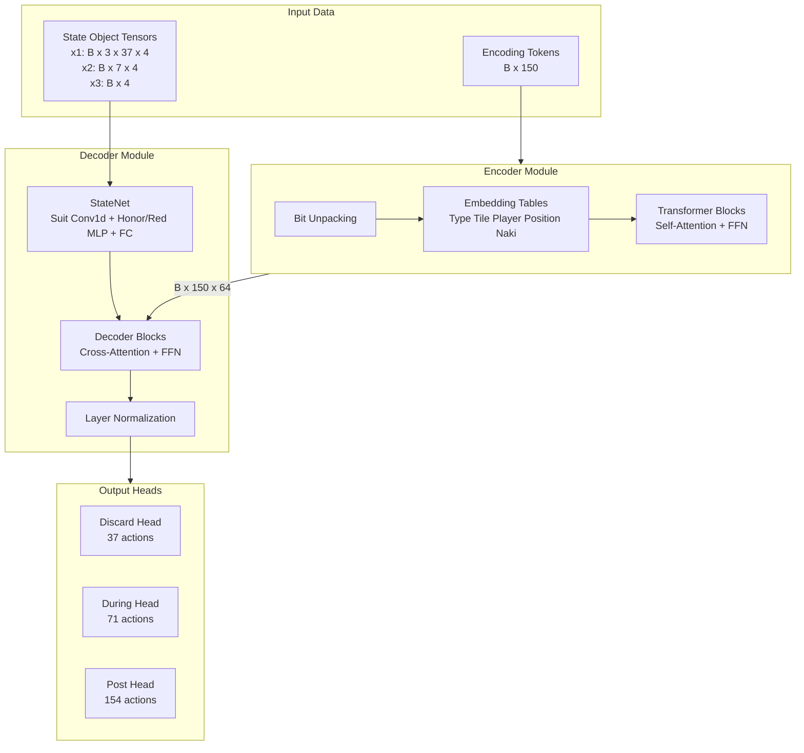
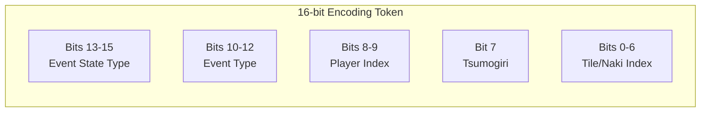
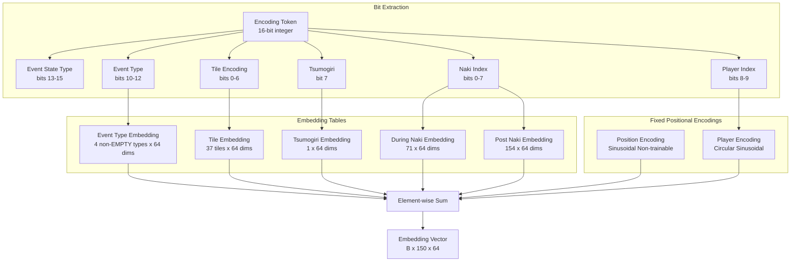
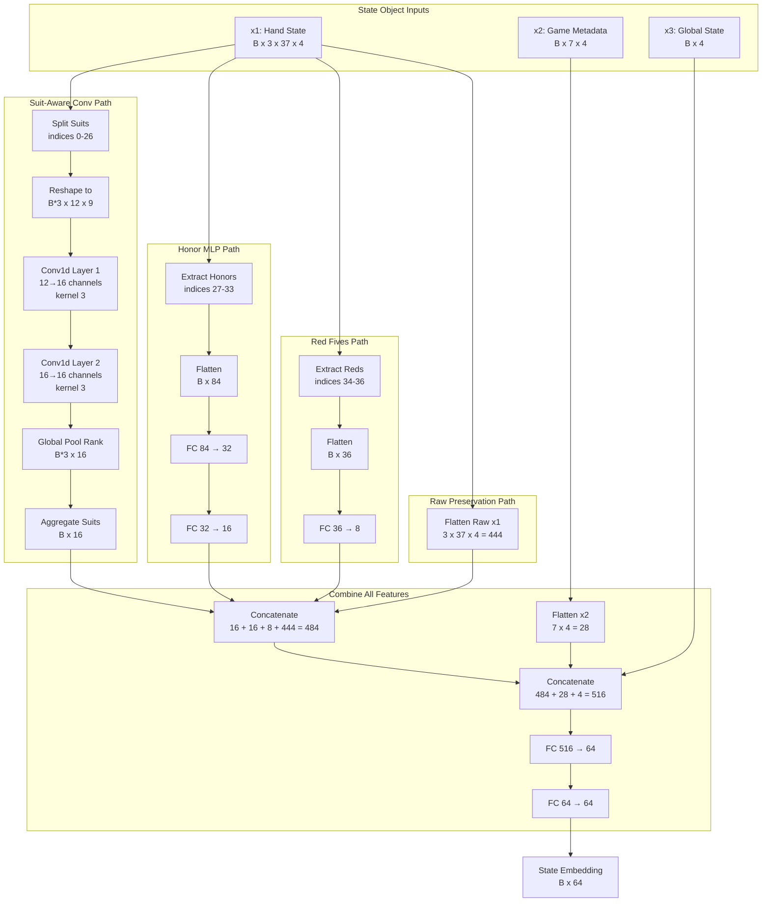
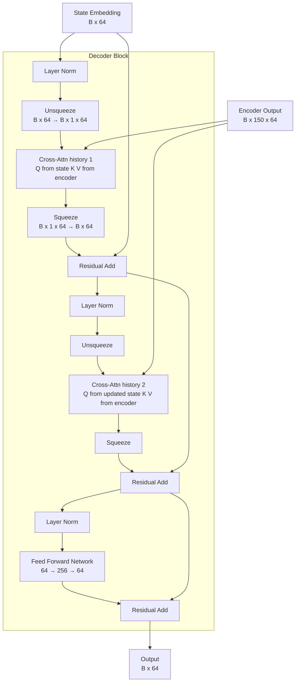
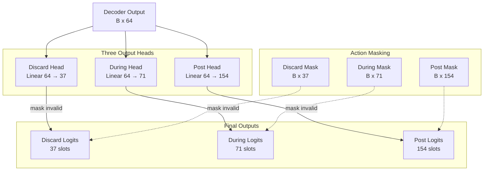
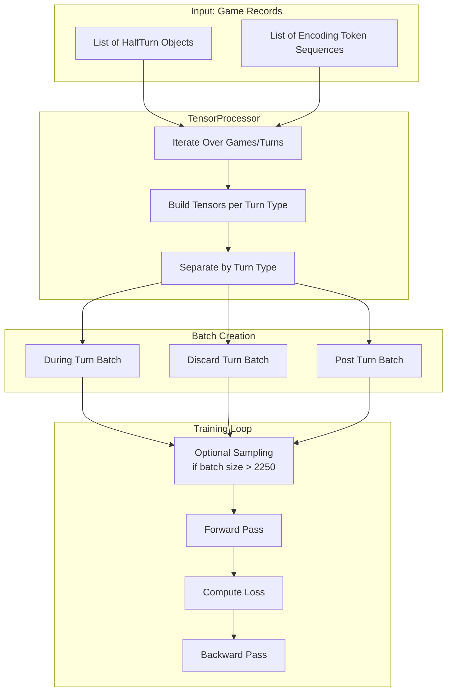

# Transformer-Conv Model Architecture

> **Status: archived, not trained.** Since T-013 this model is not a `supervised_learning.py` choice: its `forward`
> returns `{head: (logits, loss)}` tuples, not the per-head output the trainer reads, and it reads the old inputs
> (x1 with 3 planes, x3 with 4 scalars, the discarder's state for post-turn responders, no kyuushu abort action).
> The trained model is `MahjongAI/agents/encoder_conv.py` (201,311 parameters, measured; it has no architecture
> doc): 10 x1 planes in relative seats, 7 x3 scalars (the round wind added in T-038), each responder's own state.
> To revive this model: port it to the per-head output and the current inputs, then in
> `MahjongAI/supervised_learning.py` add it to `valid_models` and give `train()` its import, constructor branch and
> batch size (today `train()` raises `NotImplementedError` for every model but `encoder_conv`).

## Overview

The `TransformerConvModel` is a hybrid deep learning architecture that combines **Transformer** self-attention mechanisms with **Convolutional Neural Networks (CNNs)** to predict player actions in Japanese Mahjong (Riichi Mahjong). This model processes both sequential game history and spatial tile relationships to make informed decisions about discarding tiles, calling riichi, making melds (chi, pon, kan), and declaring wins.

### Purpose

- **Task**: Supervised learning for Mahjong action prediction
- **Input**: Game event history (up to 150 events) + current game state
- **Output**: Masked logits (actions outside this model's mask at -1e9) and a cross-entropy loss, for three decision types:
  - **Discard decisions**: Which tile to discard (37 possible tiles)
  - **During-turn decisions**: Pass, tsumo, riichi, ankan, or kakan (71 actions)
  - **Post-turn decisions**: Pass, ron, chi, pon, or minkan (154 actions); also chankan ron after a kakan
  - The counts are output slots, not counts of legal choices

### High-Level Architecture



### Model Statistics

- **Total Parameters**: 193,150 (measured, `TransformerConvModel()`)
- **Embedding Dimension**: 64
- **Attention Heads**: 8 (head size: 8)
- **Transformer Layers**: 1 (configurable via `N_LAYERS`)
- **Dropout Rate**: 0.2
- **Max Sequence Length**: 150 events

## Input Representations

### 1. Encoding Tokens (Game History)

The encoding tokens are **bit-packed integers** that efficiently represent the sequence of game events (discards, melds, riichi declarations, new dora reveals). Each token is a 16-bit integer with the following structure:



**Bit Field Breakdown:**

| Bits | Field | Description | Values |
|------|-------|-------------|--------|
| 13-15 | Event State Type | Type of game state | 0=EMPTY, 1=DISCARD, 2=DURING, 3=POST, 4=NEW_DORA |
| 10-12 | Event Type | Type of event | 0=EMPTY, 1=DISCARD, 2=NAKI, 3=RIICHI, 4=NEW_DORA |
| 8-9 | Player Index | Which player (0-3) | 0-3 |
| 7 | Tsumogiri Flag | Discard from draw | 0=false, 1=true |
| 0-6 | Tile Index | For DISCARD and NEW_DORA events | 0-36 (37 tile types) |
| 0-7 | Naki Index | For DURING and POST naki events | 0-70 for during, 0-153 for post |

**Note on EventStateTypes vs EventTypes:**
- `EventStateTypes` (bits 13-15): Indicates the phase of decision context - whether we're in a discard phase, during-turn decision, post-turn decision, etc.
- `EventTypes` (bits 10-12): Indicates the concrete event kind - what action was recorded (discard, naki call, riichi declaration, new dora reveal).

**Note on Tile vs Naki Encoding:**
- **Tile events** (DISCARD, NEW_DORA) use bits 0-6 (7 bits) to store tile index 0-36
- **Naki events** (DURING/POST naki) use bits 0-7 (8 bits) to store action index:
  - DURING naki: 0-70 (pass, tsumo, riichi, 34 ankan, 34 kakan)
  - POST naki: 0-153 (pass, ron, chi variants, pon variants, minkan)
- The decoder extracts both fields from the same token and uses the appropriate one based on event type

**Example Encoding Functions** (from `process_xml.py`):

```python
# Discard encoding
def discard2idx(who: int, tile_idx: int, is_tsumogiri: bool):
    return (EventStateTypes.DISCARD << 13 | 
            EventTypes.DISCARD << 10 | 
            who << 8 | 
            (1 if is_tsumogiri else 0) << 7 | 
            tile_idx)

# Riichi encoding
def reach2idx(who: int):
    return EventStateTypes.DURING << 13 | EventTypes.RIICHI << 10 | who << 8 | 2

# New dora encoding
def new_dora2idx(tile_idx: int):
    return EventStateTypes.NEW_DORA << 13 | EventTypes.NEW_DORA << 10 | tile_idx
```

**Tile Encoding (0-36):**
- 0-8: Man (characters) 1-9
- 9-17: Pin (circles) 1-9
- 18-26: Sou (bamboo) 1-9
- 27-33: Honors (East, South, West, North, White, Green, Red)
- 34-36: Red fives (one per suit)

### 2. State Object Tensors

The `StateObject` encapsulates the current game state from a player's perspective. It's converted into three tensors:

#### **x1: Hand State Tensor** `(batch_size, 3, 37, 4)`

Three channels encoding tile counts with one-hot-like representation:
1. **Hand tiles**: Current player's hand
2. **Remaining tiles (POV)**: Tiles not yet seen by the player
3. **Sutehai (discard pile)**: Current player's discard pile

Each of the 37 tile types is encoded as a 4-element vector using the transformation:
```python
# Convert count to one-hot-like: [0,0,0,0] for 0, [1,0,0,0] for 1, [1,1,0,0] for 2, etc.
hand_tensor = (torch.arange(4) < count.unsqueeze(1)).float()
```

#### **x2: Game Metadata Tensor** `(batch_size, 7, 4)`

Seven features for each of the 4 players:
1. **Scores**: Current point totals in raw Tenhou units, hundreds of points (25,000 points = 250)
2. **Parent tensor**: One-hot indicator of dealer
3. **Parent rounds remaining**: Rounds left as dealer
4. **Double reaches**: Double riichi status (1 or 0)
5. **Reaches**: Riichi declaration status
6. **Ippatsu**: One-shot win opportunity flag
7. **Is menzen**: Closed hand status (no open melds)

#### **x3: Global Game State** `(batch_size, 4)`

Four scalar values:
1. **Remaining tsumo**: Tiles left in the wall
2. **Kyotaku**: Riichi stick count on table
3. **Honba**: Continuation counter
4. **Rounds remaining**: Rounds left in the game

## Encoder Architecture

The Encoder processes the sequence of encoding tokens and outputs contextual embeddings for each event in the game history.

### Embedding Layer

The encoder uses multiple embedding tables to convert bit-packed tokens into rich vector representations:



**Embedding Details:**

1. **Event Type Embedding** (4 non-EMPTY types): Embeds the `EventTypes` field (bits 10-12). The embedding is applied only when the event state type (bits 13-15) is not EMPTY (else the vector is 0). It indexes the 4-slot embedding table with (EventTypes - 1), clamped at 0.
2. **Tile Embedding** (37 tiles): Learned representation for each tile type
3. **Tsumogiri Embedding**: Indicates if a discard was from the draw
4. **During Naki Embedding** (71 actions): For ankan/kakan decisions
5. **Post Naki Embedding** (154 actions): For chi/pon/minkan decisions

**Fixed Encodings (Non-trainable):**

**Position Encoding** (Sinusoidal):
```python
PE(pos, 2i) = sin(pos / 10000^(2i/d))
PE(pos, 2i+1) = cos(pos / 10000^(2i/d))
```
Captures the temporal position of each event (0-149).

**Player Encoding** (Circular):
```python
# For 4 players arranged in a circle
angle = player_idx * (2π / 4)
PlayerEnc(player, 2i) = sin(angle / 10000^(2i/d))
PlayerEnc(player, 2i+1) = cos(angle / 10000^(2i/d))
```
The player index is the token's absolute seat (bits 8-9), not a seat relative to the acting player.

**Conditional Embedding Application:**

Each embedding is only applied when relevant (controlled by masking):
- Type embedding: Applied for all non-EMPTY events
- Position encoding: Applied for all non-EMPTY events
- Tile embedding: Applied for DISCARD and NEW_DORA events
- Player embedding: Applied for DISCARD, DURING, and POST events
- Tsumogiri embedding: Applied for DISCARD events with tsumogiri=1
- During naki embedding: Applied for DURING events with naki_idx >= 3
- Post naki embedding: Applied for POST events with naki_idx >= 2

### Transformer Blocks

Each `EncoderBlock` consists of:

1. **Multi-Head Self-Attention**:
   - 8 attention heads (head_size = 8)
   - Scaled dot-product attention
   - Query, Key, Value projections

2. **Feed-Forward Network**:
   - Linear layer: 64 → 256 (4× expansion)
   - GELU activation
   - Linear layer: 256 → 64
   - Dropout (0.2)

3. **Residual Connections** + **Layer Normalization**:
   - Pre-normalization architecture
   - x = x + SelfAttention(LayerNorm(x))
   - x = x + FFN(LayerNorm(x))

**Encoder Output**: `(B, 150, 64)` - Contextualized embeddings for all game events

## StateNet: Suit-Aware Convolutional Component

The `StateNet` is a **key distinguishing feature** of this hybrid architecture. It processes the current game state tensors using **suit-aware** convolutional layers that respect Mahjong tile semantics, then combines this with other game metadata.



### Why Suit-Aware Convolutional Layers?

**Semantic Tile Relationships**: The suit-aware architecture respects Mahjong tile structure by processing tiles according to their semantic meaning:

- **Suits (Man/Pin/Sou)**: Conv1d operates along the **rank axis (1-9)** within each suit, capturing sequential tile patterns like 3-4-5 melds (chi).
- **Honors**: Processed separately via MLP, avoiding forcing them into a fake linear neighborhood.
- **Red Fives**: Extracted as separate features, maintaining their special status.
- **Count encoding**: The K=4 dimension (cumulative binary vector) is treated as feature channels, not a spatial axis.

This design ensures that convolution captures true Mahjong patterns:
- Adjacency in the convolution corresponds to rank adjacency (e.g., 4-man is adjacent to 5-man, not to 1-pin)
- Suit boundaries are respected, preventing spurious cross-suit correlations
- The same filters apply to all three suits (the same rank pattern in Man/Pin/Sou gives the same features)

### StateNet Processing Steps

1. **Suit-Aware Convolution**:
   ```
   Suits (indices 0-26):
     Extract 3 suits × 9 ranks → (B, S=3, C*K=12, R=9)
     Merge suits into batch → (B*3, 12, 9)
     Conv1d(in=12, out=16, kernel=3) over rank → (B*3, 16, 9)
     Conv1d(in=16, out=16, kernel=3) over rank → (B*3, 16, 9)
     Global pool over rank → (B*3, 16)
     Aggregate suits (mean) → (B, 16)
   ```

2. **Honor Processing**:
   ```
   Honors (indices 27-33):
     Flatten → (B, C*H*K=84)
     FC(84 → 32) → ReLU → FC(32 → 16) → (B, 16)
   ```

3. **Red Fives Processing**:
   ```
   Reds (indices 34-36):
     Flatten → (B, C*S*K=36)
     FC(36 → 8) → (B, 8)
   ```

4. **Raw Feature Preservation**:
   ```
   x1 raw: (B, 3, 37, 4) → Flatten → (B, 444)
   ```
   Preserves exact tile counts alongside learned features

5. **Feature Fusion**:
   ```
   Concat(suits_16, honors_16, reds_8, raw_444): (B, 484)
   Concat(x1_combined, x2_flat_28, x3_4): (B, 516)
   FC(516 → 64) → FC(64 → 64) → (B, 64)
   ```

**StateNet Output**: `(B, 64)` - Rich state representation combining semantically-aware CNN features and game metadata

## Decoder Architecture

The Decoder takes the StateNet output and attends to the full game history (encoder output) to produce action predictions.

### Decoder Blocks

Each `DecoderBlock` applies cross-attention in two passes:



**Attention Mechanism Details**:

1. **Cross-attention pass 1**: 
   - State queries history to get a context vector
   - Query from state embedding (current decision point)
   - Keys & Values from encoder output (all past events)

2. **Cross-attention pass 2**:
   - State queries history again after one residual update (a refinement pass)
   - Query from updated state (post-pass-1 residual, then layer normalized)
   - Keys & Values from encoder output (all past events)

3. **Feed-Forward Network**:
   - Non-linear transformation
   - 4× expansion then compression
   - GELU activation + Dropout

### Output Heads

After decoder processing and final layer normalization, the model has **three separate linear heads** for different decision types:



#### Discard Head (37 actions)

Predicts which tile to discard from hand. Actions correspond to the 37 tile types (0-36).

**Action mask**: Based on `hand_tensor` - any tile in hand (clipped to max 1.0). This legacy mask ignores kuikae
and the riichi restrictions, and a red five counts in both its plain and its red slot, so a hand with only the red
five also allows the plain five. The live model uses `utils/legal.py` (`legal_discard_mask`).

**Target**: `TILE2IDX[tile][0]`, the plain kind: a red five discard targets its plain five slot, so slots 34-36 never
get a positive target.

#### During Head (71 actions)

Predicts actions during the player's own turn after drawing a tile:
- **0**: Pass (continue to discard phase)
- **1**: Agari (tsumo - declare win)
- **2**: Riichi (declare ready hand)
- **3-36**: Ankan (closed kan) for each tile type
- **37-70**: Kakan (adding to exposed pon) for each tile type

**Action mask**: Constructed from available decisions (agari, riichi, valid ankan/kakan melds).

#### Post Head (154 actions)

Predicts actions after another player's discard, or after a kakan (chankan ron only):
- **0**: Pass
- **1**: Agari (ron - win on discard)
- **2-82**: Chi (sequential meld) - 63 basic patterns + 18 red five variants
- **83-119**: Pon (triple meld) - 27 basic + 3 red five variants + 7 honor tiles
- **120-153**: Minkan (open kan) - 34 tile types

**Action mask**: Constructed from the parser's offered decisions (ron, chi, pon, minkan) for the responder.

### Action Masking and Loss

**Masking Process**:
```python
# Mask out invalid actions (set logits to -inf)
logits = logits.masked_fill(action_mask == 0, -1e9)

# Cross-entropy loss over the masked action space
loss = F.cross_entropy(logits, target_action, reduction='mean')
```

This ensures:
1. The model only predicts actions its mask allows (the mask is not the full rule set, see the Discard Head)
2. Loss is computed only over the masked action space
3. Masked actions have near-zero probability after softmax

## Training Process

### Data Pipeline

The `TransformerTensorProcessor` class handles batch preparation:



### HalfTurn Objects

Training data consists of three types of `HalfTurn` objects:

1. **DuringTurn**: Player's own turn after drawing
   - Contains: `player`, `stateObj`, `decisions[][]`, `encoding_idx`
   - Decisions: List of lists for [agari, riichi, naki]
   - At most one executed decision marked as `executed=True` (none = pass)

2. **DiscardTurn**: Player discarding a tile
   - Contains: `player`, `stateObj`, `discarded_tile`, `encoding_idx`
   - Target: the discarded tile's plain kind (0-33; a red five targets its plain five)

3. **PostTurn**: After another player's discard, or after a kakan (chankan)
   - Contains: `player`, `stateObj`, `decisions[][][]`, `encoding_idx`
   - Decisions: 3D list [player][decision_type][options]
   - Multiple players may have decisions; usually at most one executes, but a double / triple ron marks every
     ronning responder. This model stops after the first executed responder (seat order after the discarder)
   - This model reads `stateObj` (the discarder's state) for every responder

**The current parser has changed since this model:** a `DuringTurn` has a fourth decision list (kyuushu abort);
an offered abort makes this model raise `ValueError`, and a `PostTurn` carries `responder_states`, each responder's own state.

### Batch Construction

For each turn type, the processor:

1. **Masks encoding sequence**: Zero out token values after `encoding_idx` and generate padding mask
   ```python
   masked_tokens = concat([tokens[:encoding_idx], zeros(150 - encoding_idx)])
   padding_mask = arange(150) < encoding_idx  # Boolean: True = valid position
   ```

2. **Converts state object**: Transform `StateObject` → `(x1, x2, x3)` tensors

3. **Creates action mask**: Binary tensor of the actions the model allows

4. **Extracts target**: Index of the action that was actually taken

5. **Generates padding mask**: Boolean tensor derived from `encoding_idx` (not token values)

6. **Stacks into batch**: Concatenate all examples of same type

### Training Loop

```python
for halfturns_batch, encoding_tokens_batch in dataloader:
    # Process and separate by turn type
    tensors_during, tensors_discard, tensors_post = prepare_batches(...)
    results = {}
    
    for tensors, head in [(tensors_during, 'during'), 
                          (tensors_discard, 'discard'), 
                          (tensors_post, 'post')]:
        if len(tensors[0]) == 0:
            continue
        
        # Optional sampling if batch too large
        if sample and len(tensors[0]) > sample_size:
            idx = torch.randperm(len(tensors[0]))[:sample_size]
            tensors = sample_tensors(tensors, idx)
        
        # Unpack (the padding mask is True at valid positions)
        encoding_tokens, state_obj, action_mask, targets, padding_mask = tensors
        
        # Forward pass
        enc_out = encoder(encoding_tokens, padding_mask)
        logits, loss = decoder(enc_out, state_obj, action_mask, targets, head, padding_mask)
        results[head] = (logits, loss)
    
    # Backward pass: one step on the sum of the head losses
    optimizer.zero_grad()
    sum(loss for _, loss in results.values()).backward()
    optimizer.step()
```
Everything above the backward pass is `TransformerConvModel.forward` (it returns `results`); the backward pass is
the caller's.

### Loss Function

**Cross-Entropy Loss** over the discrete action space:
```python
loss = F.cross_entropy(logits, target_action, reduction='mean')
```

Where:
- `logits`: (B, num_actions) - logits with the masked-out actions at -1e9
- `target_action`: (B,) - index of the executed action
- Reduction: Mean loss across batch

## Key Design Decisions

### 1. Hybrid Transformer + CNN Architecture

**Motivation**: Combine strengths of both architectures
- **Transformers**: Excel at sequence modeling, capture long-range dependencies in game history
- **CNNs**: Excel at local pattern recognition, capture spatial tile relationships

**Implementation**:
- Encoder (Transformer): Processes game event sequence
- StateNet (CNN): Processes current hand configuration
- Decoder: Fuses both via cross-attention

### 2. Bit-Packed Encoding Tokens

**Motivation**: Memory efficiency and compact representation

**Benefits**:
- Single 16-bit integer encodes multiple fields
- Fast bitwise operations for decoding
- Easy to extend with additional bit fields

**Tradeoff**: Requires careful bit manipulation and debugging

### 3. Player Encoding (absolute seats)

**Implementation**:
- Circular sinusoidal encoding for 4 players
- The index is the absolute seat in the token's `who` bits (`archive/transformer_conv.py`, `player_idx = (tokens >> 8) & 3`):
  the same history reads differently for the same play from another seat
- Not done here: seats relative to the acting player. `encoder_conv.py` rewrites the `who` bits so that seat 0 is the
  actor (`_relative_seats`); `archive/transformer_conv_ordered.py` subtracts the player index

### 4. Key-Padding Attention Masking

**Motivation**: Model should only attend to events that occurred before the current decision point (`encoding_idx`). Positions beyond `encoding_idx` are padding and must not influence the model's outputs.

**Implementation**:
- Generate a boolean padding mask from `encoding_idx`: `mask[i] = (i < encoding_idx)` where `True` = valid position
- Apply mask in attention: `F.scaled_dot_product_attention` with the boolean mask (a masked score is -inf before softmax); `nan_to_num` sets any NaN to 0, a defensive guard for a row with no valid position
- Zero out encoder outputs at padded positions after transformer blocks to prevent signal leakage through bias terms and LayerNorm
- Pass the same mask to decoder cross-attention to prevent attending to padded encoder positions

**Why attention masking (not just token zeroing)**:
- Simply zeroing token values still allows attention to padded positions
- Linear layers have bias terms, so zero embeddings produce non-zero keys/values
- Softmax normalization distributes probability mass across all positions including padding
- Proper attention masking with `-inf` ensures padded positions contribute exactly zero to attention outputs

**Note**: This is a **bidirectional encoder** with key-padding masking, not a causal (autoregressive) encoder. All valid positions can attend to all other valid positions within the prefix. Causal masking (preventing position `t` from attending to positions `> t` within the valid prefix) is not applied.

### 5. Action Masking

**Motivation**: Keep the model to the offered actions and focus learning on them

**Implementation**:
- Binary mask from the parser's decisions (during / post) and from the hand (discard)
- Masked actions set to -1e9 before softmax
- Loss computed only over the masked action distribution

**Benefits and limits**:
- Outputs stay inside the mask; the discard mask is not the full rule set (see the Discard Head)
- No capacity spent on masked actions
- More interpretable predictions

### 6. Three Separate Output Heads

**Motivation**: Different decision types have different action spaces

**Alternative approaches**:
- Single unified output (wasteful - 37+71+154=262 dims always)

This model is multi-task with shared layers: the encoder, StateNet and decoder are shared, and only the last linear
layer is per head.

**Benefits of separate heads**:
- Specialized output weights for each decision type
- Each head's logits cover only its own action space
- The heads still interfere through the shared layers: every head's loss updates them

### 7. Pre-Normalization Architecture

**Motivation**: Improved training stability

**Implementation**:
```python
x = x + SelfAttention(LayerNorm(x))  # Not LayerNorm(x + SelfAttention(x))
```

**Benefits**:
- Better gradient flow
- Easier optimization
- Standard in modern transformers (GPT-3, etc.)

### 8. StateNet Architecture Choices

**Why concatenate conv features with raw features?**
- Conv features: Learned spatial patterns
- Raw features: Preserve exact counts
- Both together: Best of learned + explicit representations

**Why two conv layers?**
- Layer 1: Detects basic tile combinations
- Layer 2: Combines layer 1 patterns into higher-level features
- Not tuned: no layer-count comparison was run in this repo

### 9. Single Transformer Layer

**Motivation**: Balance between capacity and overfitting

**Rationale** (not measured in this repo):
- Mahjong decisions often depend on recent events
- A single layer is assumed sufficient for a ~150 event sequence
- More layers risk overfitting on limited training data

**Configurable**: Can increase `N_LAYERS` for larger datasets

## Model Dimensions Summary

### Hyperparameters

```python
# Action dimensions
DISCARD_ACTION_DIM = 37        # 37 tile types
DURING_TURN_ACTION_DIM = 71    # pass, tsumo, riichi, 34 ankan, 34 kakan  
POST_TURN_ACTION_DIM = 154     # pass, ron, 63+18 chi, 27+3+7 pon, 34 minkan

# Sequence
MAX_ACTION_LEN = 150           # Max game events tracked
MAX_SEQUENCE_LENGTH = 150      # Same as above

# Architecture
EMBD_SIZE = 64                 # Embedding dimension
N_HEADS = 8                    # Attention heads (head_size = 8)
N_LAYERS = 1                   # Transformer encoder/decoder layers
DROPOUT_RATIO = 0.2            # Dropout probability
```

### Tensor Shapes Throughout Network

| Stage | Tensor | Shape | Description |
|-------|--------|-------|-------------|
| **Input** | encoding_tokens | (B, 150) | Bit-packed game history |
| | state_obj.x1 | (B, 3, 37, 4) | Hand state (3 channels) |
| | state_obj.x2 | (B, 7, 4) | Game metadata (7 features × 4 players) |
| | state_obj.x3 | (B, 4) | Global state (4 scalars) |
| | action_mask | (B, num_actions) | Legal action indicator |
| | target | (B,) | Target action index |
| **Encoder** | embeddings | (B, 150, 64) | After embedding sum |
| | enc_out | (B, 150, 64) | After transformer blocks |
| **StateNet** | suits_reshaped | (B*3, 12, 9) | Suits tensor for Conv1d |
| | suits_conv1 | (B*3, 16, 9) | After 1st suit conv |
| | suits_conv2 | (B*3, 16, 9) | After 2nd suit conv |
| | suits_pooled | (B*3, 16) | After global pool |
| | suits_feat | (B, 16) | After suit aggregation |
| | honors_feat | (B, 16) | After honor MLP |
| | reds_feat | (B, 8) | After red FC |
| | raw_flat | (B, 444) | Flattened raw x1 |
| | x1_combined | (B, 484) | All x1 features concatenated |
| | combined | (B, 516) | All features concatenated |
| | state_emb | (B, 64) | Final state embedding |
| **Decoder** | dec_out | (B, 64) | After decoder blocks |
| | dec_norm | (B, 64) | After final layer norm |
| **Output** | logits_discard | (B, 37) | Discard head output |
| | logits_during | (B, 71) | During head output |
| | logits_post | (B, 154) | Post head output |
| **Loss** | loss | scalar | Cross-entropy loss |

### Parameter Count Breakdown

Measured with `sum(p.numel() for p in module.parameters())` on `TransformerConvModel()` (weights + biases):

```
Encoder:                                    67,072
  - type_embedding:         4 × 64       =     256   # 4 non-EMPTY EventTypes
  - tile_embedding:        37 × 64       =   2,368
  - tsumogiri_embedding:    1 × 64       =      64
  - during_naki_embedding: 71 × 64       =   4,544
  - post_naki_embedding:  154 × 64       =   9,856   # embeddings 17,088
  - EncoderBlock × 1:                       49,984
      self-attention (Q, K, V, proj 64 × 64 + 64 each) 16,640
      feed-forward (64 → 256 → 64)                     33,088
      LayerNorm × 2                                       256

Decoder:                                   126,078
  - StateNet:                               42,168
      suit_conv1d_1   12 × 16 × 3 + 16 =    592
      suit_conv1d_2   16 × 16 × 3 + 16 =    784
      honors_fc1      84 × 32 + 32     =  2,720
      honors_fc2      32 × 16 + 16     =    528
      reds_fc         36 × 8 + 8       =    296
      fc_main_1      516 × 64 + 64     = 33,088
      fc_main_2       64 × 64 + 64     =  4,160
  - DecoderBlock × 1:                       66,752
      cross-attention 1                    16,640
      cross-attention 2                    16,640
      feed-forward (64 → 256 → 64)         33,088
      LayerNorm × 3                           384
  - ln_f + heads:                           17,158
      ln_f            64 × 2           =    128
      discard_head    64 × 37 + 37     =  2,405
      during_head     64 × 71 + 71     =  4,615
      post_head       64 × 154 + 154   = 10,010

Total: 193,150 parameters (all trainable; position / player codings are buffers)
```

## Usage Example

```python
import torch
from MahjongAI.agents.archive.transformer_conv import TransformerConvModel

# Initialize model
device = torch.device("cuda" if torch.cuda.is_available() else "cpu")
model = TransformerConvModel().to(device)

# Print parameter count
print(sum(p.numel() for p in model.parameters()))  # 193150

# Training mode
optimizer = torch.optim.AdamW(model.parameters(), lr=1e-3)
model.train()
results = model(all_halfturns_list, all_encoding_tokens_list, sample=True)  # {head: (logits, loss)}
# logits: (B, num_actions) masked logits, varies by head; loss: scalar tensor; a head without samples is absent
optimizer.zero_grad()
sum(loss for _, loss in results.values()).backward()
optimizer.step()

# Inference mode (would require additional inference wrapper)
model.eval()
with torch.no_grad():
    # Process single game state
    # Returns masked logits (softmax gives action probabilities)
    pass
```

## Architecture Update: Suit-Aware Design

**Important**: The current implementation uses a **suit-aware architecture** that was designed to fix a fundamental issue in earlier versions.

### The Problem (Previous Architecture)

The original architecture applied Conv2d with 3×3 kernels to the flat tile-index tensor (0-36), which created spurious adjacencies:
- 9-man (index 8) treated as adjacent to 1-pin (index 9)
- 9-pin (index 17) treated as adjacent to 1-sou (index 18)
- 9-sou (index 26) treated as adjacent to East wind (index 27)

This meant the CNN learned arbitrary patterns over an artificial ordering rather than true Mahjong semantics.

### The Solution (Current Architecture)

The suit-aware architecture respects tile semantics:
- **Suits**: Conv1d operates along rank (1-9) within each suit separately
- **Honors**: Processed via MLP (no fake spatial structure)
- **Red fives**: Separate feature path
- **Convolution captures real patterns**: 3-4-5 sequences, rank distributions

### Retraining Requirement

**This is a breaking architectural change.** Models trained with the old flat Conv2d architecture are **not compatible** with this suit-aware version.

To use this architecture:
1. Train a new model from scratch using `archive/transformer_conv.py` (after the port in the status note above)
2. Compare performance against baseline on held-out test data
3. Expected improvements: Better generalization on chi/sequence detection

### Retraining Guide

The training CLI is `python -m MahjongAI.supervised_learning encoder_conv <max_steps> [--run-dir ...]`; it trains
only `encoder_conv`. To train this model, port it first and wire it into `train()` (status note at the top).

**Key metrics to compare** (evaluate both on the same held-out test set):
- Overall accuracy: Discard / during / post decision accuracy
- Chi detection accuracy: Specifically test sequential meld decisions (expected improvement)
- Cross-entropy loss: Lower is better

**Breaking changes summary:**
- Model checkpoint incompatibility: old trained models cannot be loaded
- StateNet interface is unchanged (same x1/x2/x3 input/output shapes), so the data pipeline needs no changes
- Total parameter count: 193,150 (measured)
- Training hyperparameters can remain the same

### Implementation Notes

**Conv1d Kernel Size (kernel=3, padding=1)**
- Kernel size 3 captures 3-tile patterns (e.g., 3-4-5 chi sequences)
- `padding=1` preserves rank length: 9 ranks → 9 ranks after convolution
- Can be increased to 5 or 7 for a wider receptive field if needed

**Pooling Choice (global mean pooling over ranks)**
- Not exactly translation invariant: zero padding treats the rank edges differently, and the raw x1 path keeps
  absolute ranks, so 1-2-3 and 5-6-7 need not give the same features
- Could use max pooling or attention pooling for different inductive bias

**Suit Aggregation (mean across 3 suits)**
- Assumes suit symmetry (Man/Pin/Sou are equivalent), reasonable for Mahjong
- Could concatenate instead of mean-pool for suit-specific features (48 features instead of 16)

**Count Encoding (cumulative 4-bit, treated as channels)**
- `[1,1,0,0]` = 2 tiles; K=4 bits treated as feature channels (C*K=12), not a spatial axis
- Could convert to scalar counts 0–4 for a simpler representation

## Comparison with Other Variants

This repository contains multiple model variants:

| Model | File | Key Differences |
|-------|------|-----------------|
| **EncoderConv** (live) | `encoder_conv.py` | The trained model: 201,311 parameters, current inputs, per-head output |
| **TransformerConv** | `archive/transformer_conv.py` | Suit-aware hybrid model (this document) |
| Transformer | `archive/transformer.py` | StateNet: Conv1d over the flat 37 tile indices (3 → 8 → 16 channels) + FC |
| TransformerConvLarge | `archive/transformer_conv_large.py` | StateNet: Conv2d 3×3 over the flat (37, 4) tile tensor; layer count a constructor argument |
| TransformerConvOrdered | `archive/transformer_conv_ordered.py` | Player index relative to the acting player; StateNet Conv2d over the flat tile tensor |

The **TransformerConv** model balances:
- Architectural complexity (suit-aware CNN+Transformer)
- Model size (193,150 parameters)
- Training efficiency (single layer)
- **Semantic alignment** (convolution respects Mahjong tile structure)

## References and Further Reading

### Mahjong AI
- **Mahjong Game Rules**: Understanding riichi mahjong mechanics is crucial for interpreting the model
- **Shanten Calculation**: Minimum tiles needed to reach tenpai (ready hand)
- **Yaku (Winning Hands)**: Various scoring patterns the model implicitly learns

### Deep Learning Architectures
- **Transformers**: "Attention is All You Need" (Vaswani et al., 2017)
- **Pre-Normalization**: "On Layer Normalization in the Transformer Architecture" (Xiong et al., 2020)
- **CNNs for Games**: AlphaGo/AlphaZero CNN architectures for board games

### Implementation Details
- **PyTorch**: All models implemented in PyTorch
- **Supervised Learning**: Written for expert game records (haifu); this model was not trained in the current pipeline
- **Data Processing**: `process_xml.py` converts XML game logs to training data

---

**Note**: This documentation describes the architecture as of the current implementation. For the most up-to-date code, refer to `MahjongAI/agents/archive/transformer_conv.py`.
